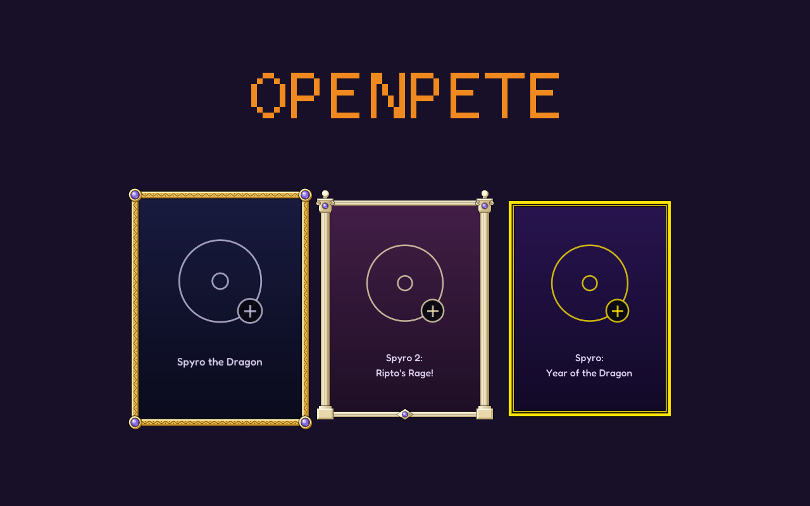
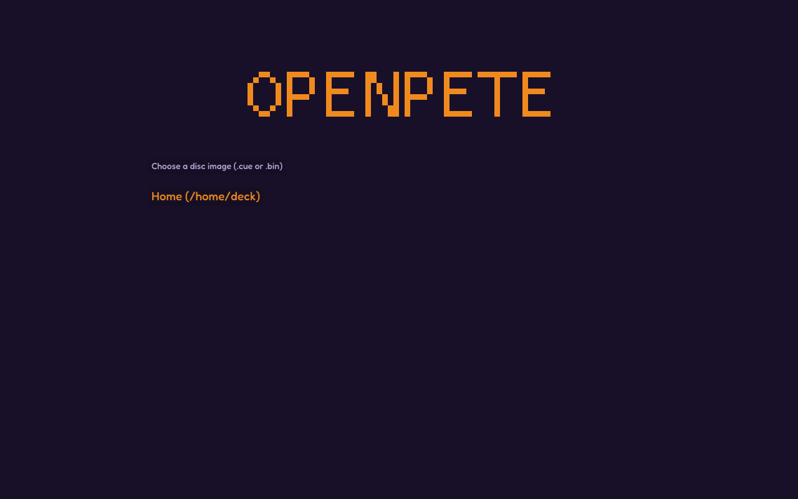

# First run

Started without naming a disc, OpenPete opens the launcher: the
[game page](../help/glossary.md#game-page), with one box per game. Choosing a
box with a disc starts that game; choosing an empty box asks for the game's
disc image.

## The game page

The page draws one box per game this package includes, in the game's own
frame: silver with corner gems for Spyro 1, cream columns for Spyro 2, a
yellow double rule for Spyro 3. An empty box shows a disc outline with a plus
sign and the game's name. One box has the focus: its frame turns gold (amber for
Spyro 3) and the box grows slightly. The page opens with the first box
focused; after a disc is added, its game's box has the focus.

Until the first disc is added, the background is plain purple and the title
is the flat orange **OPENPETE**. Everything else the page draws is read
from your disc once it is in the [library](../help/glossary.md#library):

- a box with a disc shows a picture of a level of its game and the game's
  title logo;
- the title is redrawn in the game's own 3D letters;
- the background shows the skies of the library's games' levels, one after
  another, each fading into the next.

While a level's sky shows, its name is in the bottom-right corner. Clicking
the name fades to the next level's sky; the next one after that follows 8
seconds after the fade ends. While the shader compile runs (see
[Shaders compile on start](#shaders-compile-on-start)), the bottom-left
corner shows its progress, **Compiling shaders 42%**, beside a turning
circle.

| Action | Keyboard | Gamepad | Mouse |
| --- | --- | --- | --- |
| Move the focus one box | ++left++ ++right++ | D-pad, left stick | point at a box |
| Start the game, or add its disc to an empty box | ++enter++ | South face button (Xbox A) | click the box |
| Add a disc | ++space++ | West face button (Xbox X) | drop a file on the window |
| Quit | ++esc++, or close the window | East face button (Xbox B), twice | |

++up++ and ++down++ do nothing on the page. After a key or a pad button
moves the focus, it stays on that box until the mouse moves. The first press
of the East face button shows **Press again to quit**; a second press within
2 seconds quits, and otherwise the message goes away.

## Adding a disc

Any of these gives OpenPete a disc image:

- Drag the `.bin` or `.cue` onto the window.
- Choose an empty box, or press ++space++ or the West face button on any
  box, and pick the image in the file dialog. Cancelling the dialog returns
  to the page.
- Pass the path on the command line or open the image with the program; see
  [Installing](install.md#opening-a-disc-image-directly).

The disc decides its box, not the box you chose it from: a Spyro 2 disc
picked from the Spyro 1 box is added as Spyro 2, and the focus moves to the
Spyro 2 box.

Only `.bin`/`.cue` images are accepted: given a `.cue`, OpenPete uses the
`.bin` of the same name beside it, or the only `.bin` in that folder.

The library holds one disc per game. OpenPete reads the disc before copying
it and refuses, with nothing copied:

- an image it cannot read, or one that is not a PlayStation game disc
  ([OP-E-DISC-READ](../help/troubleshooting.md#op-e-disc-read));
- a disc of a game OpenPete does not run, or of a game this package does
  not include ([OP-E-WRONG-DISC](../help/troubleshooting.md#op-e-wrong-disc));
- a second disc of a game the library already holds, another region or
  revision included; the message names the library's copy, which is left
  unchanged ([OP-E-INGEST](../help/troubleshooting.md#op-e-ingest)).

Adding the same disc image again copies it, finds it already in the library,
removes the copy and focuses its box.

### The drawn file list (Steam Deck Gaming Mode)

Under gamescope, the Steam Deck's Gaming Mode session, no system file dialog
can show and nothing can be dragged onto the window, so OpenPete draws its
own file list in place of the boxes, headed **Choose a disc image (.cue or
.bin)**. It also
opens elsewhere when the system file dialog fails to open. It starts at a
list of two places, your home folder and the mounted media under
`/run/media` (an SD card or a USB drive), each listed when it exists; a
folder lists its folders, then its `.cue` and `.bin` files.

| Action | Keyboard | Gamepad | Mouse |
| --- | --- | --- | --- |
| Move the selection | ++up++ ++down++ | D-pad, left stick | wheel |
| Open the folder, or choose the image | ++enter++ | South face button (Xbox A) | click the row |
| Go up one folder; from the first list, close | ++left++ | East face button (Xbox B) | click `..` |
| Close | ++esc++ | | |

A chosen image is added as a dropped one is.

## Preparing a game

Adding a disc runs these steps behind a progress screen: the step's name
above a bar. The first five steps share one bar, each step taking the part of
it that matches its usual share of the time, so the bar moves at an even
pace:

| Step | What it does | Share of the bar |
| --- | --- | --- |
| **Copying disc to your library** | copies the image into the library, named by its SHA-256 | 14.5% |
| **Reading game code from your disc** | reads the game's program and its level code from the copy | 2.1% |
| **Translating game code** | turns the PlayStation code into C, one part at a time | 15.6% |
| **Building for your PC** | compiles that C for your computer | 67.8%, with the next step |
| **Linking** | joins the compiled parts into the game | |
| **Rendering preview** | draws the box's level picture, shown only when it is still drawing after the build | a bar of its own |

Together these are the [first-run compile](../help/glossary.md#first-run-compile).
Measured times: about 26 seconds on a 16-thread desktop, 45 to 90 seconds
on a four-core laptop. After the copy the original image is not needed
again; the log says so. The library's location is listed under
[File locations](../help/file-locations.md).

A disc dragged onto the window or chosen in a file dialog returns to the
game page when the steps end, with its box focused; choosing the box then
starts the game. A disc given on the command line or opened with the program
starts its game straight away.

++esc++ or closing the window quits at once: the window closes and OpenPete
exits as soon as the work in progress stops. The East face button asks
first, as on the game page, with **Press again to quit** in place of the
step. A copy stopped this way leaves nothing in the library. A compile
stopped this way runs again the next time OpenPete starts.

After an update that changes the generated code, the compile runs again for
each game in the library: in the background while the game page shows, or
behind its progress screen when that game is chosen first.

### When something fails

A refused disc or a failed step shows a message on the game page, below the
boxes, ending with the error's id and the address of its row in
[Troubleshooting](../help/troubleshooting.md#by-error-id). A click on that
last line opens the row in your web browser and leaves the message shown.
Any other key, button or click closes the message and does nothing else;
++esc++, closing the window and a dropped disc still act as they do on the
page.

The message names the disc image's file and, once read, its serial; "..."
below stands for the file name:

| Message | Error id |
| --- | --- |
| **... is not a disc image OpenPete can read.**, **... names no .bin disc image.**, **... is not a PlayStation game disc** | [OP-E-DISC-READ](../help/troubleshooting.md#op-e-disc-read) |
| **... is not a disc of a game OpenPete runs.**, **... which this OpenPete package does not include.** | [OP-E-WRONG-DISC](../help/troubleshooting.md#op-e-wrong-disc) |
| **... was not added: the library already holds a disc of ...**, **... could not be copied into the library.** | [OP-E-INGEST](../help/troubleshooting.md#op-e-ingest) |
| **The library folder cannot be written:**, **... could not be added to the library folder.** | [OP-E-LIBRARY](../help/troubleshooting.md#op-e-library) |
| **... could not be built from its disc (step: ...).**, naming the game | [OP-E-MODULE](../help/troubleshooting.md#op-e-module) |

After a failed step the disc stays in the library and its box shows the
empty drawing again. The message names the step and the log file. Choosing
the box retries from the read. Until then, later starts of the same
OpenPete build do not retry it on their own.

Only one OpenPete prepares games at a time: a second one started while the
first shows the launcher draws only the message **Another OpenPete is
preparing a game.** with the id
[OP-E-LIBRARY](../help/troubleshooting.md#op-e-library), does nothing else,
and quits on the next key or button.

## Mods compile on start

Choosing a game whose mods hold source code not compiled yet, or source that
changed since the last compile, shows the step **Compiling mods (1/2)**,
counting the mods compiled and the mods to compile, before the game
starts. Mods made only of assets do
not compile. A mod that fails to compile is left out and the game starts;
the log names it. See [Mods](../customizing/mods.md).

## Shaders compile on start

The game's graphics pipelines are compiled for the graphics card and driver
and kept in a cache. The compile starts when the launcher's window opens and
runs while the game page shows. If it has not finished when a game is
chosen and takes longer than 0.4 seconds more (the first start after a new
graphics driver or a new release), the step **Compiling shaders (120/412)**
shows, counting the pipelines compiled, until it finishes. Other starts
finish the compile without showing it. While the compile runs, its
progress shows in the bottom-left corner of every other launcher screen.

## Later starts

A start without `--game` or `--disc` always opens the game page, whatever
the library holds. A launch that names its game with `--game` skips it and
starts that game's disc; see
[Installing](install.md#opening-a-disc-image-directly). Quitting the game
closes OpenPete; the launcher does not come back.

## Upgrades

Install a new release over the old one, or beside it (see
[Installing](install.md)). The first start of a new release recompiles each
game once more from the library's own copy of the disc: 12 to 50 seconds,
behind the same progress screen, starting at **Reading game code from your
disc**, or in the background while the game page shows. The original disc image is not needed.

What carries over:

| | Across an upgrade |
| --- | --- |
| Settings (`openpete.toml`) | Kept. On Windows, extracting the new zip over the old folder replaces the shipped `openpete.toml` next to the exe; your in-game saved settings live in the same file, so extract into a new folder and copy the file across, or re-save after the upgrade. |
| Memory cards | Kept. |
| Savestates | Refused by a build whose compiled game differs from the one that wrote them; the log names the state as made against a different build. Finish with savestates before upgrading. |
| Library | Kept; each release adds its own compiled build to the entry. |
| `gamecontrollerdb.txt` next to the exe (Windows) | Replaced by the new zip. Keep your own mapping lines elsewhere; see [Controllers](../customizing/controllers.md). |
